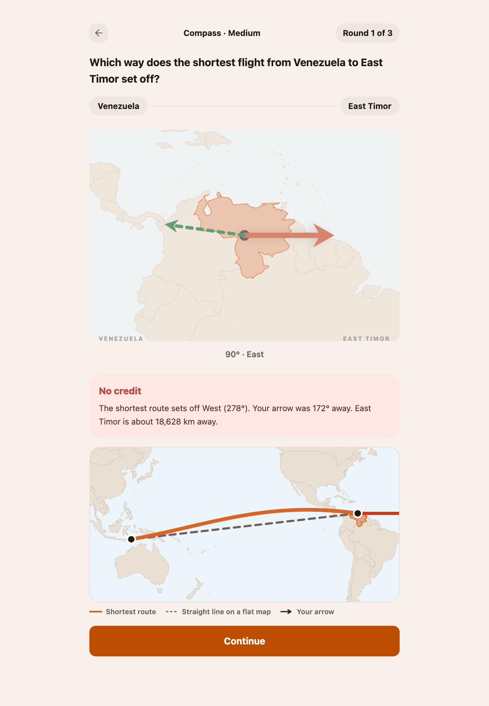
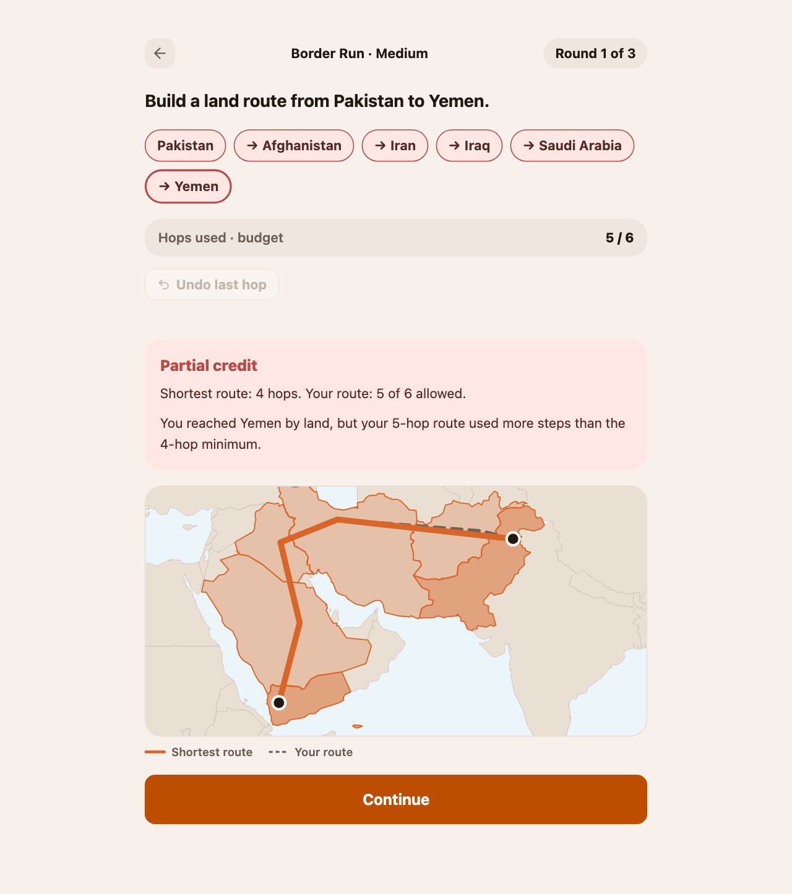

# Worldwise

Worldwise is a small daily geography game about how we picture the world. Compass asks which way the shortest route to a destination begins, then shows how that route bends across the globe. Arrange and Border Run add ordering and land-border route puzzles.

The daily challenges are deterministic and shared by every player. Progress, streaks, practice results, and the personal mental-map profile stay in the browser; there is no account or backend.

<p align="center">
  <a href="https://worldwise.kois.app">Play it live</a> ·
  <a href="#screenshots">Screenshots</a>
</p>

## Screenshots

<p align="center">
  
</p>

<p align="center">
  
</p>

## Play locally

Requirements: Bun and Node.js 22.12 or newer.

```sh
bun install
bun run dev
```

Astro prints the local URL, usually `http://localhost:4321`.

## What makes the project interesting

- Daily challenges derive from a stable date, mode, tier, generator version, and data version. The generators are deterministic and keep retry limits and fallbacks.
- Compass compares the player's answer with both a great-circle route and the direction suggested by a straight line on a Mercator map.
- Border Run scores route efficiency against the shortest land-border path and reveals both routes after the answer.
- A bounded personal answer history builds a mental-map profile entirely on the device.
- Country and adjacency data are normalized from Natural Earth at build time and committed as generated TypeScript.
- Persistence validates saved state, migrates schema versions, and recovers from corrupt browser storage.
- English and Spanish ship together; all game flows work with touch and keyboard.

## Project tour

| Path | Responsibility |
| --- | --- |
| `src/lib/modes/` | Challenge generation, validation, and scoring |
| `src/lib/challenge/` | Daily keys, progress, streaks, practice, and statistics |
| `src/lib/geo/` | Bearings, distances, routes, map projection, and border graphs |
| `src/lib/persistence/` | Local schema, validation, migration, and recovery |
| `src/client/` | Browser-side game sessions and map rendering |
| `src/pages/` and `src/components/` | Astro pages and accessible interface |
| `src/data/generated/` | Committed normalized challenge and map data |
| `docs/adr/` | Product and architecture decisions |
| `docs/case-studies/` | Short write-ups of important data and design findings |

## Data and attribution

The World collection uses Natural Earth 1:50m country geometry and capital coordinates. The derived country outlines and adjacency graph are produced from the same source geometry. Read [`src/data/world/source.md`](src/data/world/source.md) for the license, filter, coordinate semantics, known quirks, and regeneration details.

## License

Worldwise's original code and documentation are licensed under the [MIT License](LICENSE). The generated geographic data is derived from Natural Earth and remains under its public-domain terms; third-party dependencies keep their own licenses.

## Architecture notes

- [The country filter that recovered twelve countries](docs/case-studies/geographic-data-filter.md)
- [Why Compass distinguishes map direction from great-circle bearing](docs/case-studies/compass-bearing-semantics.md)
- [Border Run route-efficiency scoring](docs/adr/0009-border-run-route-efficiency-scoring.md)
- [The local mental-map profile](docs/adr/0010-local-compass-mental-map-profile.md)

## Commands

```sh
bun run dev                 # Start the local app
bun run build               # Build the static site
bun run check                # Astro and TypeScript diagnostics
bun run lint                 # Biome checks
bun run test                 # Unit tests
bun run e2e                  # Browser tests
bun run data:build           # Regenerate normalized geographic data
bun run data:build:shapes    # Regenerate country outlines and thumbnails
```
